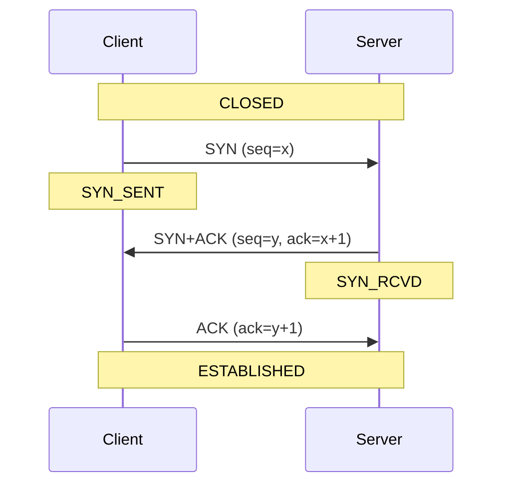
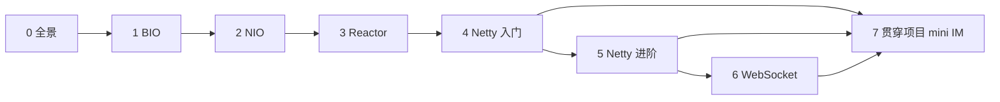

# 第 0 章 · 全景图与基线

> 一句话目标：**用最简 Java Socket 写出一个 echo 服务**，作为后续所有章节的对照基线。

---

## 0.1 为什么从原生 Socket 讲起

很多团队成员第一次接触"网络通讯"，是被 Netty 的 `ChannelPipeline`、`EventLoop` 概念劝退的。
**但这些抽象都是对底层 Socket 的封装**——如果不理解底层，调试任何 Netty 项目都会举步维艰。

本章用最朴素的 `java.net.ServerSocket` + `java.net.Socket` 写一个 echo 服务，
让读者建立**"accept → read → write → close"**的肌肉记忆，然后再逐步替换为：

```
原生 Socket  ──▶  BIO（多线程）  ──▶  NIO（多路复用）  ──▶  Reactor  ──▶  Netty  ──▶  WebSocket
   ↓                  ↓                  ↓                  ↓            ↓           ↓
  一个连接          一连接一线程       单线程多连接        事件驱动       事件驱动     HTTP 升级
  阻塞到底         伪异步队列         Selector 轮询       三种模型       高性能封装   全双工通道
```

## 0.2 Java IO 模型全景

| 模型 | 缩写 | 线程模型 | 适用场景 | JDK 支持 |
|---|---|---|---|---|
| 阻塞 IO | BIO | 一连接一线程 | 连接数少、逻辑简单 | 1.0+ |
| 非阻塞 IO | NIO | 单线程多连接（Selector） | 高并发短连接 | 1.4+ |
| 异步 IO | AIO | 回调 / Future | 长连接大文件 | 1.7+ |
| Netty | — | Reactor 主从多线程 | 绝大多数生产场景 | 第三方 |

> **学习顺序建议**：BIO → NIO → Reactor → Netty。
> AIO 在 Linux 上"伪异步"（底层仍是 epoll），且 Netty 已封装到位，**本教学体系不展开**。

## 0.3 C/S 模型与 TCP 三次握手



要点：
- `ServerSocket.bind(port)` 监听端口，对应 LISTEN 状态。
- `ServerSocket.accept()` 阻塞等待客户端连接，对应内核完成三次握手后返回。
- 一旦 `accept()` 返回，`Socket` 就处于 ESTABLISHED，可以 `getInputStream()/getOutputStream()` 收发数据。

四次挥手类似，但因 FIN 各方向独立，所以是 4 次而非 3 次。

## 0.4 第 0 章 demo：基线 echo

参见 [`module-00-overview`](../module-00-overview/README.md)。

- 服务端：`SimpleSocketEcho.java`，单连接阻塞，收到一个客户端后即退出。
- 客户端：`SimpleSocketEchoClient.java`，发 3 行字符串后退出。

**这一版只服务 1 个客户端**——这就是为什么我们需要 BIO、NIO、Netty。

## 0.5 章节依赖图



内训讲师可按学员水平**挑选讲**：
- 新人：0 → 1 → 2 → 4 → 6 → 7
- 中高级：3 → 4 🔬 → 5 → 7
- 老手刷源码：4 🔬 → 5 🔬 → 6 🔬

> 🔬 标注的子节是"源码深读"小节，可折叠。

## 0.6 学习效果自检

完成本章后，读者应能：

1. 不查文档写出 `ServerSocket.accept()` + `BufferedReader.readLine()` 的 echo 服务。
2. 画出 TCP 三次握手 / 四次挥手的时序图。
3. 说清"BIO 阻塞在哪一步、NIO 用什么机制解除阻塞"。

## 0.7 下一步

进入 [第 1 章：BIO 同步阻塞](01-bio.md)。
