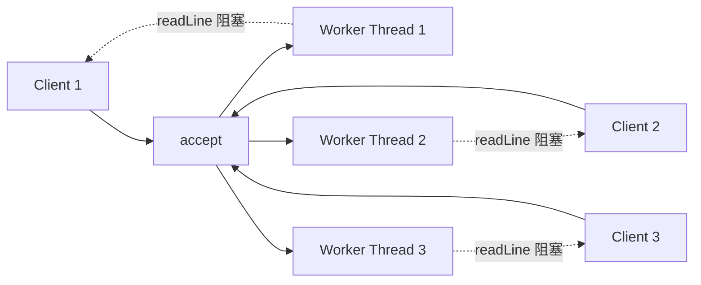

# 第 1 章 · BIO 同步阻塞

> 一句话目标：**理解一连接一线程模型与"伪异步"的瓶颈**，引出 NIO 的必要性。

---

## 1.1 模型



特点：
- 主线程死循环 `accept()`，每来一个连接起一个新 worker 线程。
- worker 线程在 `readLine()` 上**阻塞等待客户端数据**，期间不消耗 CPU。
- 并发连接数 = 线程数。1 万连接 ≈ 1 万线程（每个栈 1MB ≈ 10GB 内存）。

## 1.2 源码骨架

```java
// BioEchoServer 简化结构
ServerSocket serverSocket = new ServerSocket(port);
while (true) {
    Socket client = serverSocket.accept();              // 阻塞 ①
    new Thread(() -> {
        BufferedReader in = ...;
        String line;
        while ((line = in.readLine()) != null) {         // 阻塞 ②
            out.println("echo: " + line);
        }
    }).start();
}
```

**两个阻塞点**：
1. `accept()` —— 没客户端时线程挂起（这是 OK 的，主线程本来就该等）。
2. `readLine()` —— 已连接的客户端不发数据时，工作线程挂起（这是**真正的资源浪费**）。

## 1.3 "伪异步"优化与失败原因

```java
ExecutorService pool = new ThreadPoolExecutor(50, 50, ...);
while (true) {
    Socket client = serverSocket.accept();
    pool.execute(() -> { /* readLine 阻塞 */ });
}
```

线程池确实把线程数限制住了，但有两个新问题：

| 问题 | 表现 | 后果 |
|---|---|---|
| 队列堆积 | 客户端连接数 > 50+1000 | 拒绝新连接（`AbortPolicy`） |
| **线程假死** | 50 个线程都被 `readLine()` 阻塞 | 无法处理任何 IO，新客户端**100% 失败** |

> 伪异步只是把"无限线程爆炸"换成了"线程池假死"，本质没变。

## 1.4 与第 0 章对照

| 维度 | 第 0 章基线 | 第 1 章经典 BIO | 第 1 章伪异步 |
|---|---|---|---|
| 并发连接数 | 1 | 无限（直到 OOM） | 受限于线程池 + 队列 |
| 资源浪费 | 严重 | 严重 | 仍然严重（阻塞的本质未变） |
| 适用场景 | 教学演示 | **不推荐** | 连接数极小且稳定的内部工具 |

## 1.5 压测与观察

用 [`BioEchoClient`](../module-01-bio/README.md) 并发启动 100 个客户端：

```bash
java BioEchoClient 127.0.0.1 9091 100
```

观察：
- `BioEchoServer`：`jstack` 看到 100 个 `bio-worker-N` 线程。
- `PseudoAsyncBioEchoServer`：当并发 > 50 时，连接被 `RejectedExecutionException` 拒绝。

## 1.6 🔬 源码深读（可选）

- `java.util.concurrent.ThreadPoolExecutor`：四种 `RejectedExecutionHandler` 的语义差异。
- `SocketInputStream.read`：底层为何阻塞（参考 JDK 源码 `java.net.SocketInputStream`）。

## 1.7 下一步

阻塞的本质无法用 BIO 解决，必须切换到 **非阻塞 IO + 多路复用** → [第 2 章 NIO](02-nio.md)。
