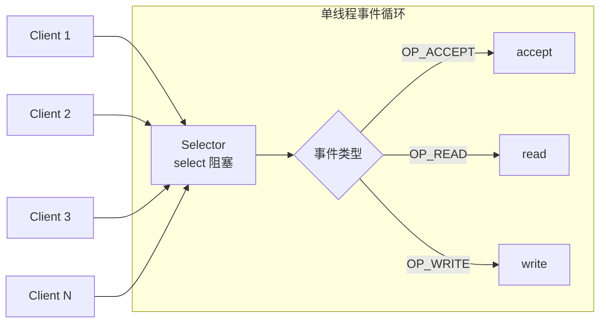

# 第 2 章 · NIO 多路复用

> 一句话目标：**用单线程 + Selector 同时服务多个连接**，从根本上消除"一连接一线程"。

---

## 2.1 模型



特点：
- 1 个线程处理 N 个连接的"事件"。每个连接空闲时（不发数据）不占线程。
- `Selector.select()` 阻塞直到至少一个 channel 有事件，**不会空转**。
- 关键问题：**业务逻辑（读、解码、业务、写）必须足够快**，否则会阻塞其他连接的处理。

## 2.2 三大件

| 件 | 作用 | 注意 |
|---|---|---|
| `Channel` | 代表一个 IO 通道（服务端 / 客户端 / 文件） | 必须 `configureBlocking(false)` |
| `Buffer` | 读写数据的容器 | `flip()` 切换读/写模式，`clear()`/`compact()` 重置 |
| `Selector` | 多路复用器，封装 epoll/kqueue | 必须在 `selectedKeys()` 中**手动移除**已处理 key |

## 2.3 源码骨架

```java
// NioEchoServer 简化结构
Selector selector = Selector.open();
ServerSocketChannel server = ServerSocketChannel.open();
server.bind(new InetSocketAddress(port));
server.configureBlocking(false);
server.register(selector, SelectionKey.OP_ACCEPT);

while (selector.select() > 0) {                  // 阻塞直到有事件
    Iterator<SelectionKey> it = selector.selectedKeys().iterator();
    while (it.hasNext()) {
        SelectionKey key = it.next();
        it.remove();                              // ← 必须 remove，否则下次还会拿到
        if (key.isAcceptable()) handleAccept(key);
        else if (key.isReadable()) handleRead(key);
    }
}
```

## 2.4 与第 1 章对比

| 维度 | 第 1 章 BIO | 第 2 章 NIO |
|---|---|---|
| 线程数 vs 连接数 | 1:1 | 1:N |
| 内存占用（10K 连接） | ~10 GB | ~100 MB |
| 业务处理阻塞影响 | 仅自己线程 | **整个 Selector 线程阻塞** |
| 编程复杂度 | 极低 | 中（ByteBuffer、SelectionKey、半包处理） |

> 第 4 章 Netty 会在 Selector 上做两件事：① 把 handler 拆到业务线程池；② 自动处理半包。

## 2.5 🔬 源码深读（可选）

- `java.nio.channels.Selector#open`：底层 Linux 上是 `epoll_create`（JDK 1.5+）。
- `SelectorImpl#select`：调用 `epoll_wait` 返回就绪 fd。
- `SelectionKey#interestOps`：修改关注的事件集，下一轮 select 生效。

## 2.6 局限与引出

本章 demo 有几个**故意简化**的地方：

1. **没有半包处理**：假设每次 `read()` 都能读到完整一行。真实场景必须用 `LengthFieldBasedFrameDecoder` 之类（第 5 章展开）。
2. **没有异步写**：`write()` 在大消息时可能阻塞，应注册 `OP_WRITE` 用事件循环驱动。
3. **业务处理在 Selector 线程**：CPU 密集型业务会阻塞所有连接的 IO。第 4 章 Netty 通过 worker 线程组解决。

进入 [第 3 章：Reactor 模式](03-reactor.md)，看 NIO 如何被组织成生产级的事件驱动架构。
