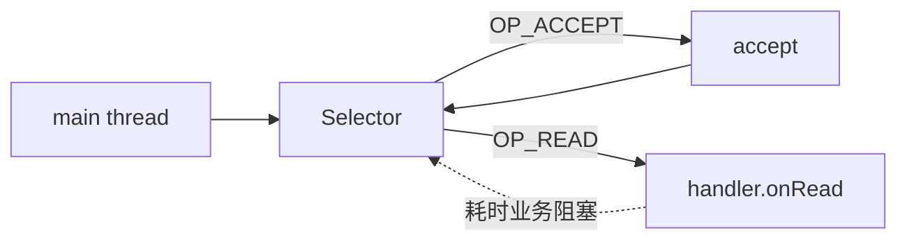
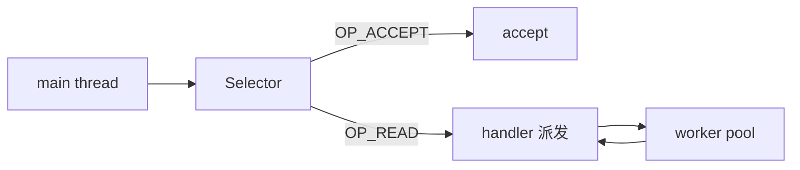
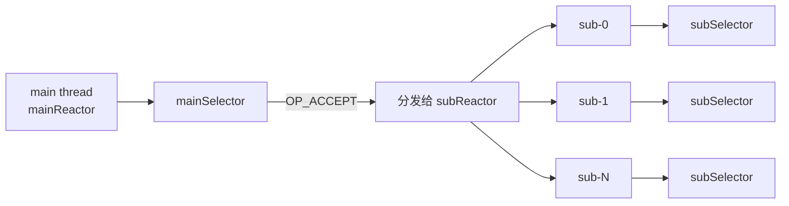

# 第 3 章 · Reactor 模式

> 一句话目标：**理解"事件驱动"的本质**，手写主从 Reactor，看清 Netty 模型的来历。

---

## 3.1 三种 Reactor 模型对比

### 3.1.1 单 Reactor 单线程



- 1 个 Selector 同时处理所有事件。
- 业务处理在该线程内同步执行。
- 缺点：业务慢 = 整个 IO 卡死。

### 3.1.2 单 Reactor 多线程



- mainReactor 只分发 IO 事件，业务扔到 worker 池。
- 但单 mainReactor 仍是瓶颈（百万长连接场景不适用）。

### 3.1.3 主从 Reactor（Netty 模型）



- mainReactor 只做 accept，避免百万连接的 accept 事件压垮单线程。
- 每个 subReactor 独立线程，单连接的所有 IO 都串行在同一线程，**无需加锁**。
- 这是 Netty 的 `bossGroup` + `workerGroup` 模型。

## 3.2 关键抽象

```java
abstract class EchoHandler {
    final SocketChannel channel;
    void onRead() throws IOException { /* read -> echo -> write */ }
}

class SingleReactorServer {
    public static void main(String[] args) {
        Selector sel = Selector.open();
        ServerSocketChannel ssc = ServerSocketChannel.open();
        ssc.configureBlocking(false);
        ssc.register(sel, OP_ACCEPT);

        while (sel.select() > 0) {
            for (SelectionKey key : sel.selectedKeys()) {
                if (key.isAcceptable()) handleAccept(key, sel);
                else if (key.isReadable()) ((EchoHandler) key.attachment()).onRead();
            }
        }
    }
}
```

## 3.3 主从 Reactor 关键设计点

1. **round-robin 分发**：`nextSub.getAndIncrement() % subCount`，保证负载均衡。
2. **跨线程注册问题**：在 mainReactor 线程上把 channel 注册到 subReactor 的 selector，必须先 `selector.wakeup()`，否则 `register()` 会被死锁。
3. **handler 与 channel 同生命周期**：handler 由 channel 注册时创建，channel 关闭时一起释放。

## 3.4 与 Netty 的对应关系

| 本章概念 | Netty 对应 |
|---|---|
| mainReactor | `ServerBootstrap` + `bossGroup` |
| subReactor 数组 | `workerGroup` |
| `EchoHandler.onRead()` | `ChannelInboundHandler.channelRead()` |
| `SelectionKey.attachment()` | `Channel.pipeline()` |
| `Selector.select()` 循环 | `NioEventLoop.run()` |

> 第 4 章起，我们直接用 Netty API。但理解这些对应关系，能让我们在 Netty 出问题时快速定位。

## 3.5 🔬 源码深读（可选）

- Doug Lea《Scalable IO in Java》—— Reactor 模式原始论文。
- `NioEventLoop.run()`：Netty 的"subReactor 事件循环"实现。
- `Selector.wakeup()`：底层如何从 epoll_wait 中唤醒。

## 3.6 下一步

进入 [第 4 章：Netty 入门](04-netty-intro.md)，看 Netty 如何把 Reactor 模式工程化。
