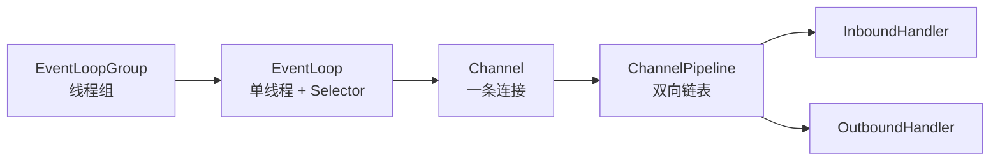

# 第 4 章 · Netty 入门

> 一句话目标：**掌握 Netty 四大组件**（EventLoop / Channel / Pipeline / Handler），写出 echo 与群聊两个 demo。

---

## 4.1 四大核心组件



| 组件 | 角色 | 与第 3 章对应 |
|---|---|---|
| `EventLoopGroup` | 一组 `EventLoop`，默认 `cpu*2` 个线程 | subReactorGroup |
| `Channel` | 一条 TCP 连接（服务端/客户端 socket） | `SocketChannel` |
| `Pipeline` | handler 责任链，双向链表 | `SelectionKey.attachment()` 的扩展版 |
| `Handler` | 业务处理单元，分 inbound / outbound | `EchoHandler.onRead()` |

## 4.2 服务端骨架

```java
EventLoopGroup boss = new NioEventLoopGroup(1);       // mainReactor
EventLoopGroup worker = new NioEventLoopGroup();      // subReactorGroup

ServerBootstrap b = new ServerBootstrap();
b.group(boss, worker)
 .channel(NioServerSocketChannel.class)               // 服务端 channel 实现
 .childHandler(new ChannelInitializer<SocketChannel>() {
     @Override
     protected void initChannel(SocketChannel ch) {   // 每个新连接触发
         ch.pipeline().addLast(new NettyEchoHandler());
     }
 });

b.bind(9096).sync();                                  // 阻塞等待绑定完成
```

## 4.3 Handler 骨架

```java
public class NettyEchoHandler extends ChannelInboundHandlerAdapter {
    @Override
    public void channelActive(ChannelHandlerContext ctx) {
        // 连接建立
    }

    @Override
    public void channelRead(ChannelHandlerContext ctx, Object msg) {
        // 收到数据（msg 是 ByteBuf）
        ByteBuf in = (ByteBuf) msg;
        ctx.writeAndFlush(in);                        // 直接回写
    }

    @Override
    public void exceptionCaught(ChannelHandlerContext ctx, Throwable cause) {
        ctx.close();
    }
}
```

## 4.4 Sharable 与群聊

群聊需要"广播"——即每个 channel 都能看到其他 channel 的存在。
做法是把"在线 channel 集合"放进 handler 的成员变量里，**handler 必须**加 `@ChannelHandler.Sharable`：

```java
@ChannelHandler.Sharable
public class NettyChatServerHandler extends ChannelInboundHandlerAdapter {
    private final Map<Channel, String> online = new ConcurrentHashMap<>();

    @Override
    public void channelActive(ChannelHandlerContext ctx) {
        online.put(ctx.channel(), "user-" + online.size());
        broadcast("welcome!");
    }
    // ...
    private void broadcast(String text) {
        ByteBuf buf = Unpooled.copiedBuffer(text, CharsetUtil.UTF_8);
        for (Channel ch : online.keySet()) {
            ch.writeAndFlush(buf.duplicate());        // ← duplicate 避免引用计数问题
        }
        buf.release();
    }
}
```

> ⚠️ **没有 `@Sharable` 就报错**：Netty 默认假设 handler 是不共享的，每个 channel 单独持有。
> 若强行共享（写 `@Sharable` 而无锁），会出现线程安全问题。

## 4.5 ByteBuf 与引用计数

`ByteBuf` 是 Netty 的字节容器，**带引用计数**：

```java
ByteBuf buf = ctx.alloc().buffer(16);
try {
    buf.writeBytes(...);
    ctx.writeAndFlush(buf);
} finally {
    // 不需要 release()：writeAndFlush 后 Netty 会自动 release
}
```

但如果**手工持有 ByteBuf 后不释放**，会内存泄漏——Netty 4 默认带 `ResourceLeakDetector` 会在日志里报告。

## 4.6 与 Reactor 章节的映射

| Netty 概念 | 本质 |
|---|---|
| `NioEventLoop.run()` | subReactor 事件循环 |
| `childHandler(ChannelInitializer)` | 在 `OP_ACCEPT` 后初始化 channel |
| `pipeline.addLast(handler)` | 把 handler 挂到 channel 的责任链 |
| `ctx.writeAndFlush()` | 提交写任务到当前 EventLoop |
| `ctx.channel().eventLoop().execute(task)` | 跨线程提交任务到 EventLoop |

## 4.7 🔬 源码深读（可选）

- `NioEventLoop.run()`：JDK Selector 与 Netty 任务队列的融合。
- `DefaultChannelPipeline`：双向链表结构，inbound / outbound 流向。
- `AbstractChannelHandlerContext`：事件传播机制（`fireChannelRead` / `invokeChannelRead`）。

## 4.8 下一步

进入 [第 5 章：Netty 进阶](05-netty-advanced.md)——协议帧、心跳、客户端重连。
