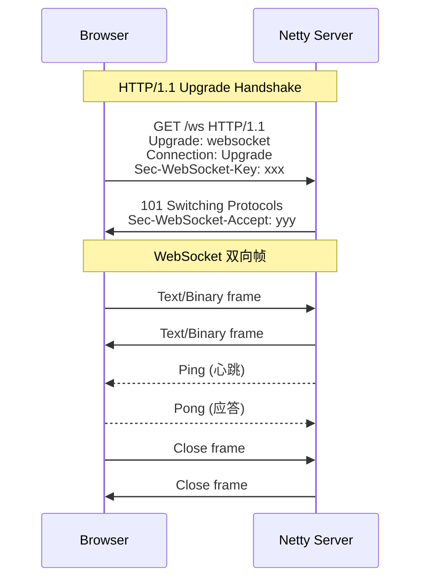

# 第 6 章 · WebSocket

> 一句话目标：**理解 WebSocket 与 HTTP 的关系，掌握 Netty 接入 WebSocket 的 pipeline 编排**。

---

## 6.1 协议关系



要点：
- **WebSocket 复用 HTTP 端口和握手**：不需要新端口。
- **握手后协议升级**：从"请求-响应"变成"双向帧流"。
- **WebSocketServerProtocolHandler** 帮你处理握手、Ping/Pong、Close，业务只关心 `TextWebSocketFrame`。

## 6.2 帧格式

```
 0                   1                   2                   3
 0 1 2 3 4 5 6 7 8 9 0 1 2 3 4 5 6 7 8 9 0 1 2 3 4 5 6 7 8 9 0 1
+-+-+-+-+-------+-+-------------+-------------------------------+
|F|R|R|R| opcode|M| Payload len |    Extended payload length    |
|I|S|S|S|  (4)  |A|     (7)     |             (16/64)           |
|N|V|V|V|       |S|             |   (if payload len==126/127)   |
| |1|2|3|       |K|             |                               |
+-+-+-+-+-------+-+-------------+ - - - - - - - - - - - - - - - +
|     Extended payload length continued, if payload len == 127  |
+ - - - - - - - - - - - - - - - - - - - - - - - - - - - - - - - +
|                               |Masking-key, if MASK set to 1  |
+-------------------------------+-------------------------------+
| Masking-key (continued)       |          Payload Data         |
+-------------------------------- - - - - - - - - - - - - - - - +
:                     Payload Data continued ...                :
+ - - - - - - - - - - - - - - - - - - - - - - - - - - - - - - - +
|                     Payload Data continued ...                |
+---------------------------------------------------------------+
```

要点（教学精简）：
- `opcode`：0x1=文本、0x2=二进制、0x8=Close、0x9=Ping、0xA=Pong
- `MASK`：客户端发到服务端必须置 1（防代理污染）
- payload length 7 / 7+16 / 7+64 三种长度

## 6.3 Pipeline 编排

```java
ch.pipeline().addLast(
    new HttpServerCodec(),                  // 1. HTTP 字节 ↔ HttpRequest/Content
    new ChunkedWriteHandler(),              // 2. 大文件分块写
    new HttpObjectAggregator(8192),         // 3. HttpContent 聚合 → FullHttpRequest
    new WebSocketServerProtocolHandler("/ws"),  // 4. 握手 / Ping / Pong / Close
    HANDLER);                               // 5. 业务 TextWebSocketFrame
```

**关键约束**：`HttpObjectAggregator` 必须在 `WebSocketServerProtocolHandler` 之前；否则 handshake 的 `FullHttpRequest` 不完整。

## 6.4 与 TCP 自定义协议对比

| 维度 | WebSocket | 第 5 章自定义协议 |
|---|---|---|
| 浏览器接入 | ✅ 天然支持 | ❌ 需 WebSocket/TCP 网关 |
| 帧边界 | 协议自带 | 需 LengthField 处理 |
| 加密 | WSS (TLS) | 自定 |
| 心跳 | 协议层 Ping/Pong | 应用层 PING/PONG |
| 跨域 | 需服务器响应 CORS | 无此问题 |

## 6.5 与生产环境的差距

- 无鉴权：生产必须加 `JwtWebSocketAuthHandler`。
- 无重连：浏览器内置指数退避重连，但需保证幂等。
- 无消息可靠投递：ACK/重传需要应用层实现。

## 6.6 🔬 源码深读（可选）

- `WebSocketServerProtocolHandler#channelRead`：握手时序。
- `WebSocket08FrameDecoder`：位运算解析帧头。
- `WebSocketServerHandshaker`：URL 路径匹配 + 协议升级。

## 6.7 下一步

进入 [第 7 章：贯穿项目 mini IM](07-mini-im.md)——把 TCP + WebSocket + 心跳 + 路由 + 离线消息合并成一个完整 IM。
