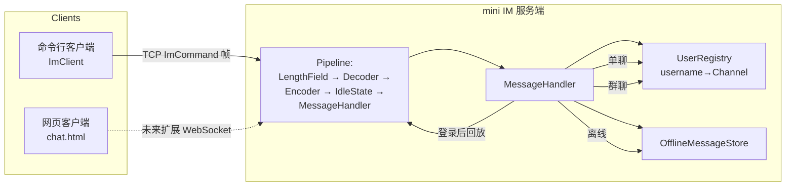

# 第 7 章 · 贯穿项目 mini IM

> 一句话目标：**把 1-6 章的所有能力合并，做一个能跑的单聊/群聊/离线消息 IM**。

---

## 7.1 架构图



## 7.2 协议设计

| 字段 | 类型 | 长度 | 含义 |
|---|---|---|---|
| type | byte | 1 | `MessageType` 枚举值 |
| fromLen | byte | 1 | 发送方用户名长度 |
| from | bytes | fromLen | 发送方用户名 |
| toLen | byte | 1 | 接收方用户名长度 |
| to | bytes | toLen | 接收方用户名；群发为 `*` |
| bodyLen | int | 4 | 消息体长度 |
| body | bytes | bodyLen | 消息正文（UTF-8） |

> 帧总长度通过 `LengthFieldBasedFrameDecoder` 在前面再加 4 字节长度字段。

## 7.3 消息类型

| type | 名称 | 方向 | 用途 |
|---|---|---|---|
| 1 | LOGIN | C→S | 登录 |
| 2 | LOGIN_ACK | S→C | 登录响应（含 offline 数量） |
| 3 | CHAT | C↔S↔C | 单聊 |
| 4 | GROUP_CHAT | C→S→所有人 | 群聊 |
| 5/6 | PING/PONG | 双向 | 心跳 |
| 7 | SYSTEM | S→C | 系统消息 |
| 8 | OFFLINE | S→C | 离线消息回放 |

## 7.4 命令行客户端协议

| 用户输入 | 服务端处理 |
|---|---|
| `login alice` | 发送 `LOGIN{from=alice}` |
| `@bob hi` | 发送 `CHAT{from=alice, to=bob, body=hi}` |
| `@all hi` | 发送 `GROUP_CHAT{from=alice, to=*, body=hi}` |
| `bye` | 关闭连接 |

## 7.5 关键设计点

### 7.5.1 用户与 channel 绑定

```java
// 登录时绑定
ctx.channel().attr(USERNAME_KEY).set(username);
userRegistry.register(username, ctx.channel());

// 断线时清理
ctx.channel().attr(USERNAME_KEY).get();  // 拿到 username
userRegistry.unregister(ctx.channel());
```

### 7.5.2 离线消息

- 单聊时目标离线 → 存到 `OfflineMessageStore`。
- 登录时 `drain(username)` 拉取并清空，封装成 `OFFLINE` 消息逐条推回。

### 7.5.3 心跳

- 服务端 `IdleStateHandler(30, 0, 0)`：30 秒读空闲关闭（防死连接）。
- 客户端 `IdleStateHandler(20, 0, 0)`：20 秒读空闲发 `PING`。
- `MessageHandler` 对 `PING` 直接回 `PONG`。

## 7.6 端到端验证

```bash
# 1. 启动服务端
mvn -pl module-07-mini-im/im-server exec:java \
    -Dexec.mainClass=com.teachlearn.im.mini.ImServer -Dexec.args="9100"

# 2. 启动客户端 A
mvn -pl module-07-mini-im/im-client exec:java \
    -Dexec.mainClass=com.teachlearn.im.mini.ImClient

# 3. 启动客户端 B（同上）
# A 端：
#   login alice
#   @bob hi bob
# B 端：
#   login bob
#   ← 看到 alice 的消息
#   @alice hi alice
```

## 7.7 局限与生产化

| 教学版 | 生产版 |
|---|---|
| 内存存储 | Redis + MySQL |
| 单实例 | 集群 + 路由层 |
| 无鉴权 | JWT + 用户态 |
| 消息不可达 | ACK + 重传 + 离线确认 |
| 无消息历史 | 时序数据库 / ES |
| 无监控 | Prometheus / 链路追踪 |

## 7.8 🔬 源码深读（可选）

- `MessageHandler.handleLogin`：离线消息回放。
- `MessageHandler.handleChat`：单聊路由与离线暂存。
- `UserRegistry.register`：踢下线旧连接（防多端登录）。

## 7.9 教学旅程回顾

```
第 0 章 基线  →  第 1 章 BIO  →  第 2 章 NIO  →  第 3 章 Reactor
    ↓               ↓                ↓                ↓
   1 线程        1:N 线程         1:N 复用         主从 Reactor
    ↓               ↓                ↓                ↓
                           第 4 章 Netty 入门
                                  ↓
                            第 5 章 Netty 进阶
                          （协议帧 + 心跳 + 重连）
                                  ↓
                          第 6 章 WebSocket 接入
                                  ↓
                       第 7 章 mini IM 贯穿项目 ✓
```

到这里你已经掌握了 Java 网络通讯的完整栈。生产中遇到任何通讯问题，**回到第 3 章 Reactor 模式找对应概念**，再读 Netty 源码即可。
